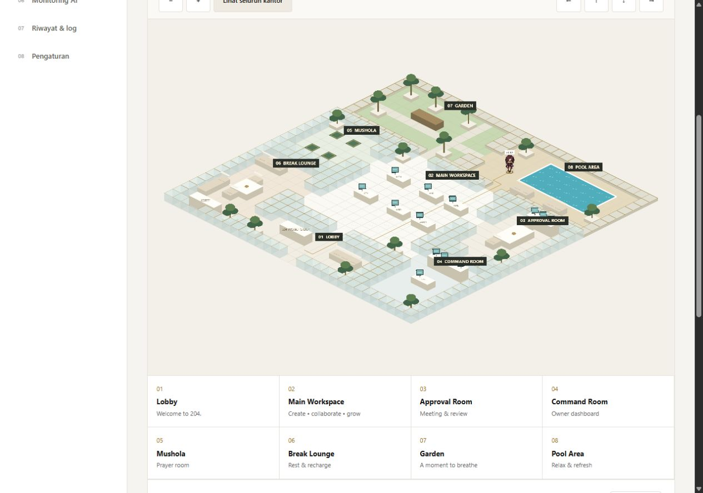

# Map delapan area — hasil implementasi

Tanggal: 27 Oktober 2026. Scope disetujui pengguna: map lengkap, akses antar-ruangan, penghalang, dan satu Akira sebagai karakter uji.

## Hasil

Map isometrik 30 × 30 petak mencakup Lobby, Main Workspace, Approval Room, Command Room, Mushola, Break Lounge, Garden, dan Pool Area. Renderer memakai geometri prosedural dengan lantai putih/marmer sederhana, pembatas kaca beraksen emas, meja, monitor, sofa, kursi, sajadah, tanaman dan kolam. Ini interpretasi interaktif dari referensi, belum kualitas render fotorealistik pada gambar sumber.

Definisi area, pintu dan furnitur berada di `apps/web/src/office/layout.ts`. Collision memakai footprint yang sama, termasuk seluruh permukaan air dan kursi. Tombol tujuan mengarahkan Akira melalui BFS empat arah; tombol fokus area memperbesar kamera. Zoom, pan, reset, jeda/lanjut, jalur visual dan status nama area tersedia.

Saat pekerjaan dilanjutkan, sheet Akira sudah berganti menjadi `Img/Karakter/Akira-General manager-Lead cordinator.png` dengan susunan enam frame per baris. Import dan frame runtime disesuaikan dengan file saat ini. Idle memakai frame depan, berjalan memakai baris samping kiri/kanan. Sheet tetap pratinjau berlatar putih dengan blending, belum atlas transparan produksi.

## Verifikasi

- PASS: `corepack pnpm test`, 6 file / 13 tes. Mencakup tujuan setiap area dari lobby, langkah bersebelahan, seluruh sel footprint furnitur/air/pembatas, tujuan invalid, dan proyeksi isometrik.
- Satu run awal terkena timeout 5 detik pada health backend. Run ulang seluruh suite lulus tanpa mengubah timeout atau kode backend.
- PASS: `corepack pnpm build`, frontend/backend dan pemeriksaan TypeScript. Build awal mendeteksi import Akira lama; sudah diperbaiki dan build ulang lulus.
- PASS: `corepack pnpm lint` setelah perubahan terakhir.
- Build memberi peringatan ukuran chunk Phaser: sekitar 1.38 MB, gzip 360 KB; scene tetap lazy-loaded. Optimasi atlas/bundle belum dilakukan.
- Browser: seluruh map tampil; perjalanan lobby → Garden diuji sebelum pergantian sheet; lobby → Pool Area diuji dengan sheet baru dan status kedatangan terverifikasi. Klik air kolam setelah zoom ditolak.
- Browser: fokus Garden/Pool, reset seluruh kantor, viewport desktop dan 390 × 844 diperiksa. Pada viewport kecil, clientWidth = scrollWidth = 375 px, canvas berjumlah satu. Ukuran browser dipulihkan setelah tes.
- Review sumber independen tidak menemukan blocker; saran menguji seluruh footprint properti diterapkan.

Tidak ada tes browser otomatis, audit screen reader menyeluruh, pengukuran FPS, atau uji seluruh jalur secara visual. Tes konektivitas otomatis mencakup delapan tujuan, bukan seluruh kemungkinan pasangan titik. Lifecycle tetap memakai cleanup pratinjau sebelumnya; navigasi remount sudah diperiksa pada OFFICE-001.

## Aset dan batas tahap

Tidak ada file Img yang ditulis oleh implementasi ini. Baseline historis dipertahankan: enam file lama yang masih sama cocok hash-nya; Akira sudah berganti nama/isi dan Zegion juga berbeda dari baseline saat sesi dilanjutkan. Perubahan sumber tersebut tidak dibatalkan. Hash Akira saat adaptasi: `6D8D91CD37063EECC133AAA103819AA4533129D946501D19E6F84696B8726840`.

Enam representasi tambahan, atlas transparan, animasi bekerja/istirahat/interaksi, workflow task, approval aktif, monitoring AI, jadwal salat dan Hermes belum dibuat. OFFICE-003 tetap parsial karena baru bagian map yang selesai. Tidak memasang dependency, commit, push, atau deploy.

Server lokal dijalankan kembali untuk pratinjau di `http://127.0.0.1:5173/#/office`. Jika berhenti, jalankan `corepack pnpm dev` dari root proyek.

## Pembaruan 27 Oktober 2026 — denah asli sebagai peta

Peta prosedural isometrik diganti dengan gambar `Img/Map/Denah Kantor Mewah 204. Project Group.png` (1536 × 1024) yang ditampilkan apa adanya. Di atasnya ada grid jalan 16 px sejajar layar (96 × 64 petak) tanpa render. Lantai, penghalang (meja, sofa, kolam, pohon, dinding) dan pintu ditulis sebagai persegi dalam piksel gambar di `apps/web/src/office/layout.ts`, lalu dijadikan petak jalan saat modul dimuat. BFS empat arah tetap dipakai. `render-map.ts` dihapus.

- Akira muncul di pintu masuk Lobby dan berjalan ke delapan area; diuji di browser ke Mushola, Pool Area, Break Lounge dan Command Room.
- Tes otomatis: setiap area terjangkau dari pintu masuk dan dari area lain; furnitur, air dan dinding tidak bisa dilewati.
- Batas: Akira selalu digambar di atas peta, jadi tidak tertutup furnitur gambar. Persegi penghalang adalah perkiraan; kalibrasi detail masih bisa disempurnakan. Interior Break Lounge di sisi kiri belum dicek jalur demi jalur.

## Pembaruan lanjutan — karakter, occlusion, workflow simulasi

- **Atlas transparan:** `node scripts/build-sprites.mjs` memotong tujuh sheet di `Img/Karakter` (tidak diubah) menjadi atlas PNG transparan di `assets/runtime/characters/` (baris bawah, samping, atas) plus `manifest.json` dan portrait per karakter. Latar dihapus dengan flood fill dari tepi sheet; sheet yang spritenya saling bersentuhan dipotong di kolom paling sepi. Arah samping lainnya memakai flip. Sisa tepi putih kecil di sekitar rambut Akira masih terlihat.
- **Tujuh karakter di peta:** Akira dapat digerakkan; Leo, Aeri, Amy, Kuro, Mail dan Zegion berdiri di posisi awal dan menjadi penghalang bagi Akira. Mereka belum bergerak sendiri.
- **Occlusion:** tiap furnitur tinggi digambar ulang dari peta yang sama di atas karakter yang berdiri di belakangnya (urutan kedalaman = tepi depan objek). Hanya bagian bawah objek yang memblokir jalan. Diuji dengan Akira berdiri di belakang meja dan resepsionis. Persegi objek adalah perkiraan, jadi sesekali sprite terpotong di tepi objek.
- **Logika gerak:** dipisah dari Phaser ke `apps/web/src/office/walker.ts` dengan lima tes (langkah, antrean tujuan, penolakan, frame panjang, reduced motion).
- **Task dan approval (simulasi):** `apps/web/src/tasks`, halaman Task board dan Approval inbox. Layanan palsu di memori, berlabel Simulasi. Enam tes mencakup alur, versi hasil, idempotensi, dan alasan revisi. Belum terhubung ke avatar di peta.
- **Belum dikerjakan:** PRAYER-001 (butuh sumber jadwal dan lokasi), backend/database/realtime, AI nyata, desktop/deploy (butuh kredensial, anggaran, dan keputusan Anda), animasi kerja/duduk, FPS.

## Pembaruan — peta digambar dari kode

Peta foto diganti dengan peta yang digambar dari kode (Phaser Graphics, vektor), sehingga tetap tajam saat diperbesar dan tidak ada tempelan label. Gambar di `Img/Map` kini hanya referensi desain di halaman Ringkasan.

- **Denah** ada di `apps/web/src/office/layout.ts`: 96 × 64 petak 16 px. Ruangan adalah persegi lantai; dinding tumbuh otomatis di sekelilingnya; pintu adalah celah yang dipotong di dinding dan selalu terbuka. Dinding tidak bisa ditembus dan pintu tidak ditutup. Dinding antara ruang dalam dan luar berupa dinding, pagar rendah atau pagar tanaman.
- **Penggambar** di `render-map.ts` (lantai marmer/kayu/rumput/dek, dinding bertinggi, air kolam yang berkilau) dan `props.ts` (meja kerja, meja rapat, resepsionis, layar dashboard, sofa, konter, rak, pohon, pohon sakura, palem, lampu, payung, mihrab, dan lainnya). Lampu memakai cahaya tambahan.
- **Kedalaman nyata:** setiap objek punya kedalaman dari tepi depannya, jadi karakter di belakang meja atau dinding tertutup dengan benar tanpa lapisan potongan gambar.
- **Tes:** tiap pintu terbuka dan dapat dilalui, dinding dan furnitur memblokir, setiap area saling terjangkau, dan berpindah ruangan selalu lewat pintu.
- **Batas:** bentuk bangunan lebih sederhana dari gambar referensi (persegi, bukan miring), furnitur masih gaya sederhana, dan sprite karakter belum punya pose duduk atau berenang. Kolam sudah berupa zona air sendiri, jadi berenang dan duduk bisa ditambahkan begitu sprite-nya ada.

## Pembaruan — mengikuti foto referensi

Denah disusun ulang mengikuti `Img/Map`: siluet bertingkat, Garden dan Pool di atas, Main Workspace di tengah, Mushola (dengan ruang kecil di atasnya) dan Break Lounge di kiri, Approval Room dan Command Room di kanan, serta Lobby dengan tangga masuk di bawah. Susunan furnitur mengikuti foto: empat gugus meja dengan pot di tengah, meja rapat di atas, resepsionis dan dinding "204." di Lobby, konsol melengkung di Command Room, sajadah hijau di Mushola, pohon besar dengan paving di Garden. Gaya gambar ditambah garis tepi gelap, bayangan, karpet, dan lebih banyak tanaman. Perbedaan yang tersisa: bangunan berbentuk persegi bertingkat (bukan miring seperti foto), dan detailnya jauh di bawah gambar render aslinya.

## Pembaruan — peta isometrik interaktif (dari kode yang Anda kirim)

Halaman Kantor virtual kini memakai peta dari kode HTML yang Anda kirim, dipindahkan ke React: `apps/web/src/office/IsoOffice.tsx` (tampilan), `zones.ts` (data delapan zona dan koordinatnya), `splash.ts` (percikan air di kanvas), dan `iso-office.css`. Gambar dasarnya `assets/runtime/maps/office-iso.jpg` (1376 × 768, diunduh sekali dari alamat Google di kode itu, 258 KB). Isinya: sorotan zona saat di-hover, pin, tooltip, panel detail di kanan (Esc menutup, panah kiri/kanan berpindah zona, tombol Previous/Next), pilihan zona, kilau air kolam, gelembung jacuzzi, bebek, ayunan pohon, lampu taman, papan "204." di Lobby, dan percikan saat kolam diklik.

Penyesuaian dari kode asli: animasi CSS menimpa atribut `transform` SVG sehingga bebek dan cahaya pohon muncul di pojok kiri-atas peta; posisinya kini ditanam di koordinat. Zona dapat dipakai dengan keyboard (Tab, Enter) dan panel detail tidak bisa difokus saat tertutup. Font Google (Plus Jakarta Sans, JetBrains Mono) tidak dimuat; aplikasi memakai font bawaannya.

Dihapus: peta Phaser dan karakter berjalan (kode peta vektor, jalur, penghalang, dan tes-nya ada di riwayat git), serta dependensi `phaser`. Atlas karakter di `assets/runtime/characters` dan `scripts/build-sprites.mjs` tetap ada untuk dipakai lagi. Karakter berjalan perlu jalur dan penghalang yang dikalibrasi ulang ke gambar baru.

## Pembaruan — detail di bawah peta, tulisan menempel di dinding

Bar alat di atas peta dan bar petunjuk di bawahnya dihapus. Memilih zona (klik di peta atau tombol di bawah peta) membuat peta zoom ke zona itu dan detailnya tampil tepat di bawah peta, bukan di panel samping; Esc atau "Lihat seluruh kantor" kembali ke tampilan penuh. Tulisan "204. PROJECT GROUP" di Lobby kini digambar langsung di panel marmer dinding (serif Playfair Display, dibundel lewat `@fontsource/playfair-display`) tanpa papan hitam yang tampak menempel.

## Pembaruan — peta lebih bersih, Leo di Command Room

Panel detail zona, titik pin, dan lapisan sorotan hijau dihapus; zona kini hanya tombol dan area klik tak terlihat. Memilih zona (di peta atau tombol) membuat peta zoom ke zona itu, dan memilihnya sekali lagi atau menekan Esc kembali ke tampilan penuh. Area zona kini persegi yang disetel ke isi gambar, sehingga zoom tepat di ruangannya. Saat di-zoom, gambar memakai `image-rendering: pixelated` agar tepi piksel tetap tegas, bukan kabur; gambar sumber hanya 1376 × 768, jadi ketajaman penuh butuh gambar beresolusi lebih besar. Halaman Ringkasan memakai peta yang sama (bukan lagi gambar referensi berlabel) dan menautkannya ke peta interaktif. Leo berdiri di Command Room (sprite dari `assets/runtime/characters/leo.png`) dan bernapas pelan; belum berjalan.
